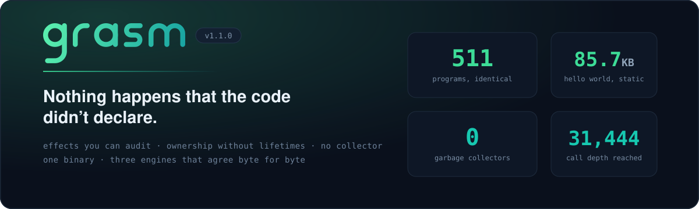
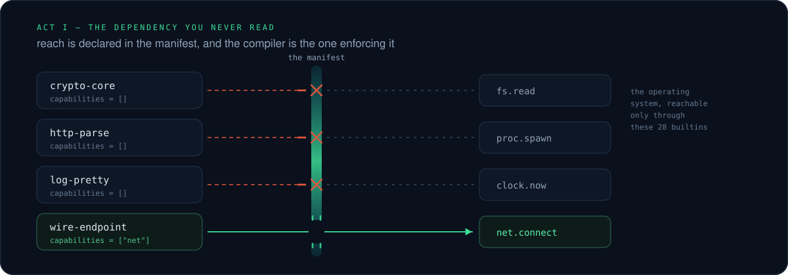
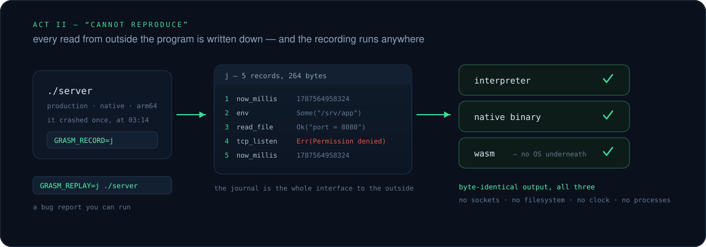
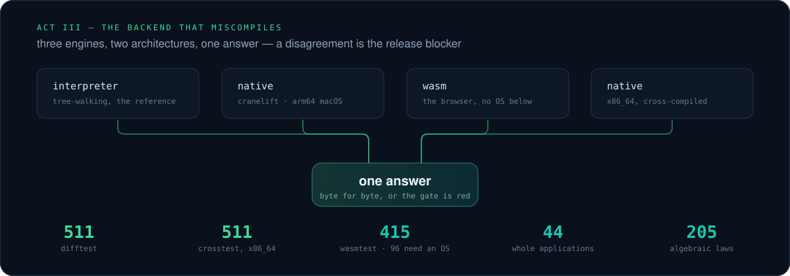
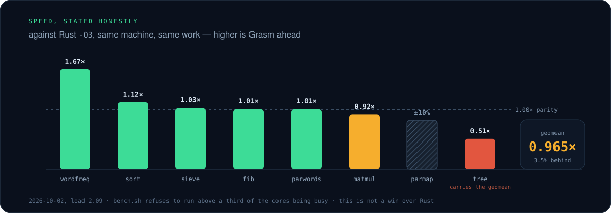

<p align="center">
  
</p>

<p align="center">
  <a href="https://grasm-lang.github.io"></a>
  
  
  
</p>

<p align="center">
  <b><a href="https://grasm-lang.github.io">Website</a></b> ·
  <a href="https://grasm-lang.github.io/playground.html">Playground</a> ·
  <a href="docs/overview.md">Guide</a> ·
  <a href="spec/">Spec</a> ·
  <a href="docs/northstar.md">Scorecard</a>
</p>

---

# Three stories. One compiler that answers them.

<br>

### I. The dependency you never read

> A patch release lands. Four thousand lines of transitive diff, and one of them
> opens `~/.aws/credentials`. You find out from a bill.



In Grasm, reach is a **declaration**, not a convention. A package that says
`capabilities = []` cannot open a socket, read a file, spawn a process or ask
the time — and it isn't a sandbox catching it at runtime, it's the compiler
refusing to build it.

```toml
# grasm.toml — a crypto library has no business outside its own arithmetic
[package]
name = "crypto-core"
capabilities = []          # ← the whole attack surface, on one line
```
```
error: package `crypto-core` performs [io] but permits []
```

<br>

### II. "Cannot reproduce"

> It crashed once, at 03:14, on a machine you can't log into. You have a stack
> trace, a log line, and a week.



Every read from outside the program goes through **28 builtins**, and
`GRASM_RECORD` writes down what each one returned. That journal *is* the bug
report. `GRASM_REPLAY` runs it back — on a different engine, in a sandbox with
no sockets, no filesystem, no clock and no processes.

```sh
GRASM_RECORD=crash.j ./server      # production
GRASM_REPLAY=crash.j grasm run server.gr   # your laptop, same bytes out
```

<br>

### III. The backend that miscompiles

> It worked in the interpreter. It worked in debug. Then the optimiser got it,
> and now one branch in ten thousand is wrong.



Three engines, two architectures, **one answer**. Every program in the corpus
runs on all of them every gate run, and the outputs are compared byte for byte.
When they disagree, nothing ships — that is the release blocker, not a filed
issue.

<br>

---

## The niche nobody else fills

- 🔒 &nbsp;**A library you can prove is inert.** Capabilities are per package and checked at the boundary. "This crate cannot phone home" stops being a promise.
- 🔁 &nbsp;**A bug report that runs.** A recording made by a native binary replays inside a wasm module that has no OS underneath it.
- 📐 &nbsp;**A spec small enough to hand to a machine.** `spec/` fits in one context window *on purpose* — designed to be a language an agent gets right, not one it guesses at.
- ⚖️ &nbsp;**Differential correctness as the product.** Not a test suite bolted on. The thing being sold.

## If you already write something else

| You write | What carries over | What's gone |
|---|---|---|
| **Rust** | ownership, ADTs, exhaustive matching, typed error flow | lifetime annotations, `Send`/`Sync` puzzles, six separate tools |
| **Go** | fast builds, one static binary, cheap concurrent tasks | the garbage collector, `interface{}`, nil at runtime |
| **Zig** | nothing hidden, no allocation you didn't ask for | hand-threaded allocators and `defer` for memory |
| **TypeScript / Python** | ADTs, inference, iteration speed | a runtime to install, and type errors that wait until production |

Honest about the trade: on eight benchmark programs Grasm's geomean is
**0.965× of Rust `-O3`**. That is **3.5% behind**. It is not a win over Rust,
and the chart below shows exactly which program carries the deficit.

## Packages: Blade, and no second tool to install

Every other ecosystem hands you a second program — `pip`, `npm`, `cargo`,
`maven`, `gem`, `conan`. Grasm folds it in, the way `go`, `zig`, `deno` and
`bun` do:

| Elsewhere | Here |
|---|---|
| `pip install` · `npm i` · `cargo add` | `grasm add` |
| `cargo publish` · `npm publish` · `gem push` | `grasm publish` |
| `cargo update` · `npm ci` · `bundle install` | `grasm deps` → `grasm.lock` |
| crates.io · PyPI · npm registry | **Blade** |

**Blade** is the registry packages live in. It is a name for the place, not a
program to install — the commands above are subcommands of the one binary you
already have, and every package in Blade declares its capability ceiling, which
is the thing no other registry can tell you.

## Is this a Rust wrapper?

No. A `.gr` file never becomes Rust source and never touches `rustc`.

| Stage | What it produces |
|---|---|
| `grasm_syntax` | its own lexer, parser and formatter |
| `grasm_sema` | its own types, **effect rows**, ownership, exhaustiveness |
| `grasm_interp` | the normative answer every other engine must match |
| `grasm_native` | **Cranelift IR → an object file** |
| `grasm_sys` | the operating system over **raw syscalls and libc — no `std`** |

Cranelift is a code generator, the way LLVM is one for Clang, Swift and Rust
itself. Nobody calls Rust C++-based because LLVM is written in C++.

**Nothing of the host survives into what you ship.** All four crates a compiled
program links are `#![no_std]`; `grasm_rt_abi` supplies Grasm's own
`#[global_allocator]` and `#[panic_handler]`. A hello-world is **85.7 KB**
and `nm` finds no Rust standard library in it.

The compiler is *written in* Rust today, the way Rust's first compiler was
written in OCaml and Go's in C. That is a bootstrap, and it is the one thing
here designed to be replaced — [`MASTERPLAN.md`](MASTERPLAN.md) puts
self-hosting at Phase 4. The language does not depend on it.

## Speed, stated honestly



## Measured, 15 October 2026

| Gate | What it compares | Programs |
|---|---|---:|
| `difftest` | interpreter · native · bundle agree | **511** |
| `crosstest` | cross-compiled x86_64, identical | **511** |
| `wasmtest` | identical in the browser engine | **415** |
| `ProjectGold` | whole applications, every engine | **44** |
| `fuzz_laws` | algebraic laws against arithmetic | **205** |
| `depth` | nested calls reached, 10,000 promised | **31,444** |

| Goal | Target | Measured |
|---|---|---|
| Hello-world static binary | ≤ 300 KB | **85.7 KB** |
| Frontend throughput | ≥ 500k LOC/s | **535–547k** |
| Edit → diagnostic | ≤ 50 ms | **p50 21 ms** |
| Lightweight tasks | 1M per node | **1,000,000 in 22 s** |

> **One gate is red on purpose.** The specification is 71 pages against the 50
> it binds itself to. Raising the ceiling would meet the number by redefining
> it. [`docs/known-issues.md`](docs/known-issues.md) prices the fix.

## Taste

```grasm
effect Clock { fn now() -> i64 }

type Shape = | Circle(r: f64) | Rect(w: f64, h: f64)

fn area(s: Shape) -> f64 {
    match s {                        // exhaustive, or it does not compile
        Circle(r) -> 3.14159 * r ^ 2
        Rect(w, h) -> w * h
    }
}

fn load(path: str) -> str ! IoError / {io} {   // the `/ {io}` is enforced
    try read_file(path)
}

fn main() {
    with Clock handled_by ClockHandler{ now: || 1000 } {
        print("{Clock.now()}: {[Circle(1.0), Rect(2.0, 3.0)].map(|s| area(s)).sum()}")
    }
}
```

## Built in it

**GrasmWire** — a VPN protocol written entirely in Grasm. Field arithmetic,
cipher, authenticator, hash, key schedule, handshake, protocol: **3,099 lines,
nothing underneath but this compiler.**

Checked against RFC 8439, 7693, 7748 and 5869, then checked again against an
implementation sharing no code with it — 753 random cases a run, whole handshake
included. Two processes bring a tunnel up over real UDP, rekey, follow a roaming
peer, and refuse a replayed handshake.

**Every package below the endpoint declares no capabilities at all.** The curve,
the hash, the AEAD and the handshake cannot open a socket or read a clock.
Randomness and time arrive as arguments. → [`docs/grasmwire.md`](docs/grasmwire.md)

## Start

```sh
curl -fLO https://github.com/grasm-lang/grasm/releases/latest/download/grasm-aarch64-apple-darwin
chmod +x grasm-aarch64-apple-darwin && mv grasm-aarch64-apple-darwin grasm
./grasm run hello.gr
```

**One binary, eighteen subcommands, nothing to install beside it** — no runtime,
no package manager to bootstrap. Intel Macs take `grasm-x86_64-apple-darwin`;
checksums are in `SHA256SUMS` beside them.
[All downloads →](https://github.com/grasm-lang/grasm/releases/latest)

Building from source needs a Rust toolchain to bootstrap the compiler, the way
every language starts — [`docs/overview.md`](docs/overview.md) has it, and
nothing of that toolchain reaches what you ship.

| What | Where |
|---|---|
| 🌐 Website, tour, playground | **[grasm-lang.github.io](https://grasm-lang.github.io)** |
| 📘 Full guide, install, every subcommand | [`docs/overview.md`](docs/overview.md) |
| 📐 Language specification | [`spec/`](spec/) |
| 📊 Goals against measurements | [`docs/northstar.md`](docs/northstar.md) |
| 🗺️ Strategy and roadmap | [`MASTERPLAN.md`](MASTERPLAN.md) |
| 🐛 Open defects, with reproducers | [`docs/known-issues.md`](docs/known-issues.md) |
| 🔎 101 findings from building it | [`ProjectGold/FINDINGS.md`](ProjectGold/FINDINGS.md) |

<p align="center"><sub>Pre-alpha. One platform exercised (arm64 macOS); Linux type-checks and has never been linked.<br>Every number on this page comes from the gate run that produced it, recorded in <code>site/facts.json</code>.</sub></p>
